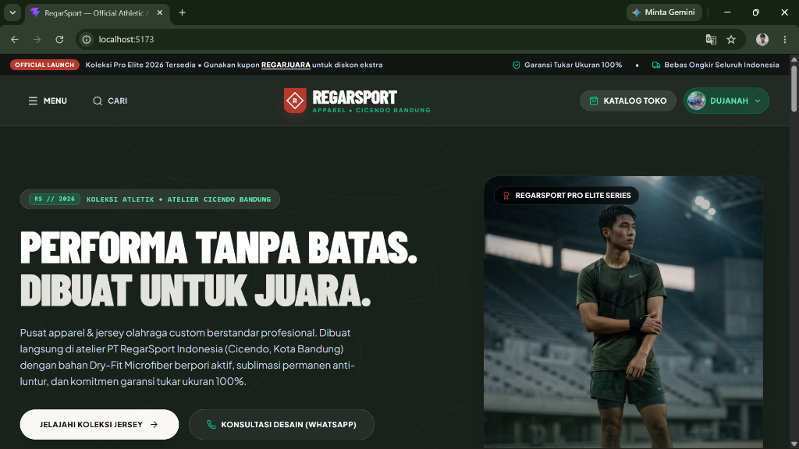
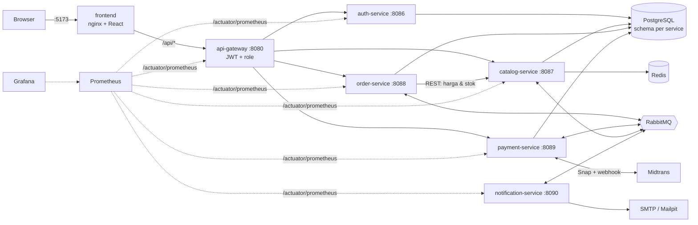
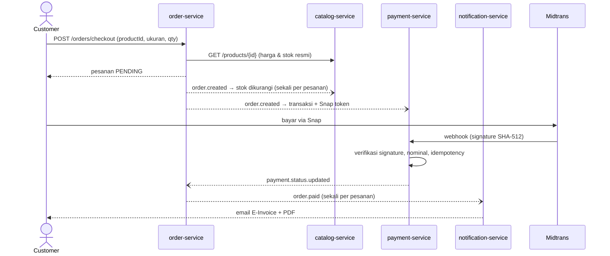
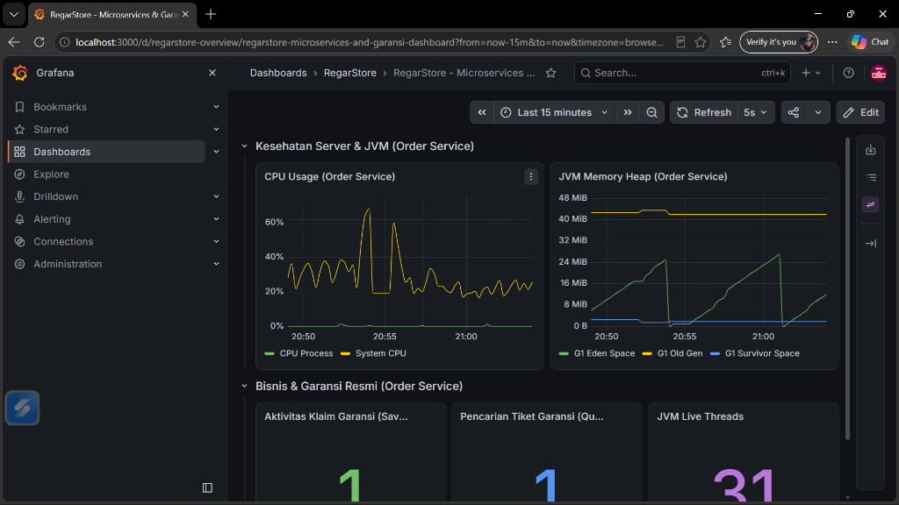

# RegarStore

E-commerce apparel olahraga dan custom jersey yang dibangun sebagai **sistem microservices Java**: enam service Spring Boot di belakang satu API Gateway, berkomunikasi lewat REST dan event RabbitMQ, dengan frontend React. Seluruh stack berjalan dengan satu perintah `docker compose up`.

**Demo:** https://regarstore.145.79.8.137.sslip.io (Midtrans mode Sandbox, gunakan [simulator pembayaran](https://simulator.sandbox.midtrans.com))

[](https://github.com/Yuuashura/bang-abu/actions/workflows/ci.yml)




## Daftar Isi

- [Ringkasan](#ringkasan)
- [Arsitektur](#arsitektur)
- [Fitur](#fitur)
- [Keamanan & Integritas Data](#keamanan--integritas-data)
- [Menjalankan Secara Lokal](#menjalankan-secara-lokal)
- [Panduan Pengujian](#panduan-pengujian)
- [Konfigurasi](#konfigurasi)
- [Deploy ke Dokploy](#deploy-ke-dokploy)
- [Ringkasan API](#ringkasan-api)
- [Pengujian Otomatis & CI](#pengujian-otomatis--ci)
- [Monitoring](#monitoring)
- [Struktur Proyek](#struktur-proyek)
- [Troubleshooting](#troubleshooting)
- [Keterbatasan yang Diketahui](#keterbatasan-yang-diketahui)
- [Pengembang](#pengembang)

## Ringkasan

| | |
|---|---|
| **Domain** | Katalog jersey dengan stok per ukuran, keranjang, checkout, pembayaran Midtrans Snap, e-invoice PDF, pengiriman, klaim garansi (RMA), ulasan, voucher |
| **Backend** | Java 21, Spring Boot 3.3, Spring Cloud Gateway (WebFlux), Spring Data JPA, Spring Security, Spring AMQP |
| **Data** | PostgreSQL (schema terpisah per service), Redis (cache katalog), RabbitMQ (event antar service) |
| **Frontend** | React 19, Vite 8, Tailwind CSS 4, React Router 7 |
| **Integrasi** | Midtrans Snap, Cloudinary, Google Sign-In, SMTP (Mailpit untuk lokal) |
| **Observability** | Spring Actuator + Micrometer, Prometheus, Grafana |
| **Kualitas** | 94 unit/web test (JUnit 5, Mockito, AssertJ, MockMvc), GitHub Actions CI |

Yang paling menarik untuk ditinjau ada di sisi Java: [aturan otorisasi terpusat di gateway](backend/api-gateway/src/main/java/com/regarsport/gateway/filter/AuthenticationFilter.java), [verifikasi webhook Midtrans + idempotency](backend/payment-service/src/main/java/com/regarsport/payment/service/WebhookService.java), [sinkron stok berbasis event yang idempotent](backend/catalog-service/src/main/java/com/regarsport/catalog/service/StockSyncService.java), [harga checkout yang diambil dari katalog](backend/order-service/src/main/java/com/regarsport/order/client/CatalogClient.java), [alur OTP](backend/auth-service/src/main/java/com/regarsport/auth/service/AuthService.java), dan [render e-invoice PDF](backend/notification-service/src/main/java/com/regarsport/notification/service/InvoicePdfService.java).

## Arsitektur



| Service | Tanggung jawab | Penyimpanan |
|---|---|---|
| **api-gateway** | Satu-satunya pintu masuk. Validasi JWT, otorisasi berbasis role, meneruskan identitas ke service lain lewat header `X-User-*`, agregasi Swagger | – |
| **auth-service** | Registrasi + OTP email, login (password & Google), refresh token, profil, lupa/ganti password, manajemen user oleh admin | `regarsport_auth` |
| **catalog-service** | Produk, kategori, stok per ukuran, ulasan, upload gambar (Cloudinary / lokal), sinkron stok dari event pesanan | `regarsport_catalog` + Redis |
| **order-service** | Keranjang, wishlist, checkout, voucher, status pesanan, pengiriman, klaim garansi, dashboard admin | `regarsport_order` |
| **payment-service** | Transaksi Midtrans Snap, webhook pembayaran, sinkron status ke Midtrans | `regarsport_payment` |
| **notification-service** | Email konfirmasi pesanan, e-invoice PDF saat lunas, notifikasi pengiriman | – |

Setiap service punya schema PostgreSQL sendiri dan tidak membaca tabel milik service lain. Data lintas domain didapat lewat REST (misalnya order-service menanyakan harga ke catalog-service) atau lewat event.

### Event RabbitMQ

| Routing key | Publisher | Consumer → efek |
|---|---|---|
| `order.created` | order-service | payment-service → buat transaksi & Snap token · catalog-service → kurangi stok · notification-service → email konfirmasi |
| `payment.status.updated` | payment-service | order-service → status pesanan PAID / CANCELLED |
| `order.paid` | order-service | notification-service → email e-invoice + lampiran PDF |
| `order.cancelled` | order-service | catalog-service → kembalikan stok |
| `order.shipped` | order-service | notification-service → email nomor resi |

### Alur checkout sampai invoice



## Fitur

**Pelanggan**
- Katalog dengan filter kategori, pencarian, detail produk dengan stok per ukuran, ulasan.
- Registrasi dengan verifikasi OTP email. Akun yang belum terverifikasi diarahkan ke halaman OTP saat login.
- Login dengan Google. Akun Google bisa menambahkan password (verifikasi OTP), dan akun biasa bisa menghubungkan Google dengan email yang sama.
- Keranjang, wishlist, voucher, checkout, pembayaran Midtrans Snap, pelacakan status pesanan, tagihan/invoice yang bisa diunduh, e-invoice PDF ke email saat lunas.
- Klaim garansi (tukar ukuran / cacat produksi) untuk pesanan selesai.

**Admin & staf gudang**
- Dashboard penjualan (grafik, ekspor CSV/PDF), CRUD produk & kategori dengan upload gambar, stok per ukuran.
- Proses pesanan: ubah status, input resi, cetak label pengiriman A6 (satuan & massal).
- Kelola voucher, user (role & suspend), ulasan, klaim garansi.
- Role `ROLE_LOGISTICS` hanya mendapat akses gudang: inventaris, pesanan, garansi.

**Platform**
- Satu `docker compose up` untuk seluruh stack. Data demo (5 kategori, 10 produk) dan akun admin dibuat otomatis saat pertama kali start.
- Responsive dari 320 px sampai desktop. Dialog konfirmasi konsisten untuk aksi destruktif.

## Keamanan & Integritas Data

| Aspek | Implementasi |
|---|---|
| Autentikasi | JWT HS512 (access 24 jam, refresh 7 hari). Password BCrypt cost 12. |
| Otorisasi | Gateway memvalidasi JWT lalu mengecek role dari satu tabel aturan (`AuthenticationFilter.requiredRoles`): tulis produk/kategori, voucher, ulasan admin, dashboard → `ROLE_ADMIN`; ubah stok, daftar semua pesanan → admin atau staf gudang. Ditutup oleh test. |
| Harga | Checkout **tidak menerima harga dari browser**. order-service mengambil harga, nama, gambar, dan stok dari catalog-service. |
| Webhook Midtrans | `signature_key` diverifikasi (SHA-512 order_id + status_code + gross_amount + server key), nominal dicocokkan dengan transaksi, lalu idempotency per `order_id + status` dengan unique constraint. Validasi dilakukan **sebelum** apa pun disimpan, sehingga webhook palsu tidak bisa "mengunci" notifikasi asli. |
| Stok | Dikurangi/dikembalikan dari event, tepat sekali per pesanan (tabel `processed_events`). Pengembalian hanya terjadi kalau stok memang pernah dikurangi. |
| OTP | 6 digit `SecureRandom`, berlaku 15 menit, maksimal 5 percobaan, cooldown kirim ulang 60 detik. Tidak pernah ditulis ke log atau dikembalikan di response. |
| Google Sign-In | ID token diverifikasi ke Google (`aud`, `iss`, `email_verified`). Email terdaftar yang belum tertaut ditolak, tidak otomatis digabung. |
| Gambar | File lama di Cloudinary dihapus **setelah** transaksi commit dan hanya jika tidak dipakai produk/kategori lain. |
| Secret | Semua kredensial dibaca dari environment. Repo tidak menyimpan secret. |

## Menjalankan Secara Lokal

**Prasyarat**: Docker Desktop (atau Docker Engine + Compose v2) dengan alokasi memori minimal 4 GB, disarankan 6 GB. Tidak perlu Java atau Node di mesin.

```bash
git clone https://github.com/Yuuashura/bang-abu.git
cd bang-abu
cp .env.example .env
docker compose up -d --build
```

Nilai default `.env.example` langsung jalan tanpa akun pihak ketiga apa pun: PostgreSQL lokal, email ke Mailpit, Midtrans mode mock, gambar disimpan lokal.

Build pertama memakan waktu sekitar 5–10 menit (unduh dependency Maven dan npm). Setelah container naik, service Java butuh sekitar 1–2 menit untuk siap. Cek dengan:

```bash
docker compose ps
```

```bash
curl http://localhost:8080/actuator/health
```

| Alamat | Isi |
|---|---|
| http://localhost:5173 | Aplikasi (UI + API lewat nginx) |
| http://localhost:8080/swagger-ui.html | Swagger UI semua service |
| http://localhost:8025 | Mailpit, inbox email lokal (OTP, invoice, notifikasi) |
| http://localhost:15672 | RabbitMQ management (`guest` / `guest`) |
| http://localhost:9090 | Prometheus |
| http://localhost:3001 | Grafana (`admin` / `admin`) |

**Akun bawaan**

| Role | Email | Password |
|---|---|---|
| Admin | `admin@regarstore.com` | `Admin12345!` (dari `ADMIN_PASSWORD` di `.env`) |
| Customer | daftar sendiri di `/register` | kode OTP ada di Mailpit |

Menghentikan stack: `docker compose down`. Menghapus juga datanya: `docker compose down -v`.

**Akses publik dengan ngrok (opsional).** Untuk demo dari luar jaringan, atau agar notifikasi Midtrans sampai ke lokal:

1. Isi `NGROK_AUTHTOKEN`, `NGROK_DOMAIN` (static domain gratis), dan `NGROK_MAIL_AUTH` di `.env`. Tambahkan `tunnel` ke `COMPOSE_PROFILES`, lalu set `FRONTEND_URL=https://<NGROK_DOMAIN>`.
2. Jalankan `docker compose up -d`, lalu lihat link-nya:

   ```bash
   docker compose logs ngrok
   ```

   ```text
   ================================================================
    Frontend : https://<NGROK_DOMAIN>
    Mailpit  : https://xxxx.ngrok-free.app   (login: NGROK_MAIL_AUTH di .env)
   ================================================================
   ```

Satu agent ngrok membuka dua tunnel, karena akun gratis hanya boleh satu sesi agent. Matikan ngrok lain yang memakai akun yang sama. Mailpit publik diberi basic auth karena inbox-nya berisi OTP. URL Mailpit berganti setiap container ngrok restart.

## Panduan Pengujian

Skenario di bawah bisa diikuti berurutan. Kolom "Hasil" adalah perilaku yang seharusnya terjadi.

### 1. Registrasi & verifikasi OTP

| Langkah | Hasil |
|---|---|
| Buka `/register`, daftar dengan email apa saja (misalnya `tester@example.com`) | Diarahkan ke halaman "Aktifkan Akun Anda" |
| Buka Mailpit, salin kode 6 digit, lalu masukkan | Langsung login dan masuk ke katalog |
| Masukkan kode yang salah | Pesan "Kode verifikasi salah. Sisa percobaan: 4." |
| Klik "Kirim Ulang Kode" sebelum 60 detik | Ditolak dengan sisa waktu tunggu |
| Login dengan akun yang belum diverifikasi | Diarahkan ke halaman OTP, kode baru terkirim |

### 2. Belanja & stok

| Langkah | Hasil |
|---|---|
| Pilih produk, pilih ukuran, tambah ke keranjang, checkout | Pesanan berstatus **Menunggu Pembayaran** |
| Buka detail produk lagi | Stok ukuran tersebut berkurang sesuai jumlah yang dibeli |
| Batalkan pesanan dari halaman detail pesanan | Status **Dibatalkan**, stok kembali |
| Checkout dengan jumlah melebihi stok | Ditolak: "Stok … tidak mencukupi (tersisa n)" |

### 3. Pembayaran

Mode mock tidak membuka popup Snap, jadi pembayaran disimulasikan dengan webhook ber-signature, persis seperti yang dikirim Midtrans. Ambil nomor pesanan dan total dari halaman **Pesanan Saya**, lalu jalankan (Linux/macOS/Git Bash):

```bash
./scripts/simulate-payment.sh REGAR-1791838230728-FAEF 249000
```

| Langkah | Hasil |
|---|---|
| Jalankan perintah di atas | `Webhook processed successfully`, pesanan menjadi **Lunas** |
| Cek Mailpit | Satu email "E-Invoice Pesanan … [LUNAS]" dengan lampiran `Invoice-<nomor>.pdf` |
| Jalankan perintah yang sama sekali lagi | `Already processed`, tidak ada email kedua |
| Jalankan dengan total yang berbeda | 400 "Nominal pembayaran tidak sesuai dengan transaksi" |

Untuk mencoba popup Snap sungguhan, isi `MIDTRANS_SERVER_KEY` dan `MIDTRANS_CLIENT_KEY` dengan key Sandbox dari dashboard Midtrans, lalu jalankan `docker compose up -d --build`. Bayar memakai [Midtrans Payment Simulator](https://simulator.sandbox.midtrans.com). Status tersinkron saat halaman detail pesanan dibuka.

### 4. Keamanan API

Ambil token customer (setelah registrasi pada skenario 1):

```bash
TOKEN=$(curl -s -X POST localhost:8080/api/v1/auth/login -H 'Content-Type: application/json' \
  -d '{"email":"tester@example.com","password":"<password>"}' | jq -r .data.accessToken)
```

| Uji | Perintah | Hasil |
|---|---|---|
| Customer menghapus produk | `curl -i -X DELETE localhost:8080/api/v1/products/1 -H "Authorization: Bearer $TOKEN"` | `403` |
| Customer membuat voucher | `curl -i -X POST localhost:8080/api/v1/orders/vouchers -H "Authorization: Bearer $TOKEN" -H 'Content-Type: application/json' -d '{"code":"GRATIS"}'` | `403` |
| Harga dimanipulasi | `curl -s -X POST localhost:8080/api/v1/orders/checkout -H "Authorization: Bearer $TOKEN" -H 'Content-Type: application/json' -d '{"shippingAddress":"Jl. Uji 1","items":[{"productId":1,"quantity":1,"size":"L","price":1}]}'` | `totalAmount` sama dengan harga katalog, bukan 1 |
| Webhook palsu | `curl -s -X POST localhost:8080/api/v1/payments/midtrans/webhook -H 'Content-Type: application/json' -d '{"order_id":"REGAR-x","status_code":"200","gross_amount":"1.00","transaction_status":"settlement","signature_key":"palsu"}'` | 400 "Signature webhook Midtrans tidak valid" |
| Tanpa token | `curl -i localhost:8080/api/v1/orders/my-orders` | `401` |

### 5. Admin

Login sebagai admin, lalu buka `/admin`.

| Langkah | Hasil |
|---|---|
| Products → tambah produk dengan gambar | Produk muncul di katalog (gambar disimpan lokal atau di Cloudinary) |
| Ganti gambar produk lalu hapus produknya | Dengan Cloudinary aktif, file lama terhapus dari Media Library |
| Orders → pesanan lunas → Cetak Label A6 | Preview label pengiriman, bisa dicetak |
| Orders → input resi | Status **Dikirim**, email resi masuk ke Mailpit |
| Users → ubah role / nonaktifkan user | Dialog konfirmasi muncul, perubahan tersimpan |
| Logout | Dialog konfirmasi muncul. "Batal" membuat sesi tetap aktif. |

### 6. Lain-lain

- **Lupa password**: `/forgot-password` → OTP di Mailpit → password baru → login berhasil. OTP tidak bisa dipakai dua kali.
- **Responsive**: buka DevTools (device toolbar), coba 320 px, 375 px, 768 px, dan desktop.
- **Monitoring**: Prometheus → Status → Targets, keenam service `UP`. Grafana → dashboard "RegarStore - Microservices & Garansi Dashboard".

### Uji end-to-end otomatis

```bash
pwsh ./test-e2e.ps1
```

PowerShell 7 tersedia di Windows, macOS, dan Linux. Skrip ini login sebagai admin, membuat produk, checkout, mengirim webhook ber-signature, memverifikasi status PAID dan e-invoice di Mailpit, lalu menghapus produk ujinya. Skrip berhenti di langkah pertama yang gagal.

## Konfigurasi

Semua konfigurasi ada di satu file `.env` di root. Docker Compose membacanya otomatis.

| Variabel | Default `.env.example` | Keterangan |
|---|---|---|
| `COMPOSE_PROFILES` | `local-db` | Menyalakan PostgreSQL lokal. Hapus jika memakai Supabase/Postgres eksternal. |
| `DB_HOST` `DB_PORT` `DB_NAME` `DB_USER` `DB_PASSWORD` | `postgres` `5432` … | Koneksi database. Untuk Supabase gunakan Transaction pooler (port 6543). |
| `JWT_SECRET` | contoh hex | **Wajib diganti** di production (hex acak ≥ 64 karakter). |
| `ADMIN_EMAIL` `ADMIN_PASSWORD` `ADMIN_NAME` | `admin@regarstore.com` … | Akun admin dibuat sekali saat auth-service pertama start. |
| `RABBITMQ_USER` `RABBITMQ_PASSWORD` | `guest` | Dipakai broker dan semua service. |
| `MIDTRANS_SERVER_KEY` `MIDTRANS_CLIENT_KEY` | `…TEST_KEY…` | Mengandung `TEST_KEY` = mode mock. Isi key Sandbox untuk Snap sungguhan. |
| `MIDTRANS_IS_PRODUCTION` | `false` | |
| `FRONTEND_URL` | `http://localhost:5173` | URL publik frontend: callback Midtrans dan tautan di email. |
| `STORAGE_PROVIDER` `CLOUDINARY_*` | kosong | Kredensial Cloudinary kosong = gambar disimpan di volume Docker. |
| `GOOGLE_CLIENT_ID` | kosong | OAuth Client ID (Web). Kosong = tombol Google disembunyikan. Authorized origin: `http://localhost:5173`. |
| `MAIL_*` | kosong | Kosong = Mailpit. Isi untuk SMTP sungguhan (contoh Gmail ada di `.env.example`). |
| `MAIL_FROM` | `noreply@regarstore.com` | Alamat pengirim. Brevo/Resend hanya menerima sender yang sudah diverifikasi. |
| `GRAFANA_PASSWORD` | `admin` | Password user `admin` Grafana. |

Menjalankan frontend dengan hot reload di luar Docker: `cd FE/regarsport-frontend && npm install && npm run dev`. Frontend akan memanggil gateway di `http://localhost:8080`.

## Deploy ke Dokploy

Repo ini punya dua branch:

| Branch | Untuk | Bedanya |
|---|---|---|
| `main` | Lokal & pengujian | Port terbuka di localhost, Mailpit, Postgres lokal, nilai default langsung jalan |
| `deploy` | Server (Dokploy) | Tanpa port host (hanya frontend yang dibuka lewat Traefik), tanpa Mailpit, env produksi wajib diisi |

Hanya `docker-compose.yml` dan `.env.example` yang berbeda. Perubahan kode cukup dikerjakan di `main`, lalu dibawa ke server:

```bash
git switch deploy && git merge main && git push origin deploy
```

**Server.** VPS Linux dengan [Dokploy](https://docs.dokploy.com/docs/core/installation), minimal 2 vCPU / 4 GB RAM ditambah swap 4 GB (build Maven + enam JVM). Jika memakai Supabase `ap-southeast-1`, pilih region Singapura.

**Langkah.**

1. Dokploy → Create Service → **Compose**. Sumber: repo GitHub ini, branch `deploy`, Compose Path `./docker-compose.yml`.
2. Tab Advanced → aktifkan **Isolated Deployments** (semua service di satu network sendiri, Traefik ikut tersambung).
3. Tab Environment → isi mengikuti `.env.example` di branch `deploy`.
4. Tab Domains → service `frontend`, port `80`, HTTPS dengan Let's Encrypt. Opsional: domain kedua untuk `grafana` port `3000`.
5. Deploy. Build pertama memakan beberapa menit.

**Setelah domain aktif.**

- Midtrans Dashboard (Sandbox) → isian **Payment Notification URL**: `https://<domain>/api/v1/payments/midtrans/webhook`.
- Google Cloud Console → OAuth client → Authorized JavaScript origins: tambahkan `https://<domain>`. Google mewajibkan HTTPS, jadi domain uji `traefik.me` (HTTP) tidak bisa dipakai untuk login Google.
- SMTP harus sungguhan karena registrasi membutuhkan OTP lewat email.

## Ringkasan API

Dokumentasi lengkap (Swagger UI, bisa dicoba langsung) dengan skema request/response:

- Demo: **https://regarstore.145.79.8.137.sslip.io/swagger-ui.html**
- Lokal: **http://localhost:5173/swagger-ui.html** (atau langsung ke gateway di port 8080)

Pilih service di dropdown kanan atas. Untuk endpoint yang butuh login, panggil `POST /api/v1/auth/login`, salin `accessToken`, lalu klik **Authorize**. Spesifikasi OpenAPI per service (`/v3/api-docs/auth`, `/catalog`, `/order`, `/payment`) bisa di-import langsung ke Postman lewat **Import → Link**. Semua endpoint memakai prefix `/api/v1`; `/api/v1` sendiri bukan endpoint, jadi wajar mengembalikan 404.

| Area | Endpoint utama | Akses |
|---|---|---|
| Auth | `POST /auth/register` · `/verify-email` · `/resend-verification` · `/login` · `/google` · `/refresh` · `/forgot-password` · `/reset-password` | publik |
| Akun | `GET /auth/me` · `PUT /auth/profile` · `PUT /auth/password` · `POST /auth/google/link` · `POST /auth/password/setup[/request]` | login |
| Katalog | `GET /products` · `/products/{id}` · `/categories` · `/products/{id}/reviews` | publik |
| Katalog (kelola) | `POST/DELETE /products` · `PUT /products/{id}` · `PATCH /products/{id}/stock` · `POST/PUT/DELETE /categories` | admin (PUT/PATCH: admin & gudang) |
| Upload | `POST /upload` (multipart, maks 10 MB, JPG/PNG/WEBP/GIF) | login |
| Keranjang & wishlist | `/cart` · `/wishlist` | login |
| Pesanan | `POST /orders/checkout` · `GET /orders/my-orders` · `GET /orders/{id}` · `PATCH /orders/{id}/cancel` · `/complete` | login (pemilik) |
| Pesanan (staf) | `GET /orders` · `PATCH /orders/{id}/status` · `/ship` | admin & gudang |
| Voucher | `POST /orders/vouchers/validate` (login) · `GET/POST/PATCH/DELETE /orders/vouchers` (admin) | |
| Pembayaran | `GET /payments/order/{id}` · `GET /payments/sync/{orderNumber}` · `POST /payments/midtrans/webhook` (publik, ber-signature) | |
| Garansi | `POST /warranty-claims` · `GET /warranty-claims` · `GET /warranty-claims/admin` · `PATCH /warranty-claims/{id}/status` | login / staf |
| Admin | `/admin/users` · `/admin/reviews` · `GET /orders/admin/dashboard` · `GET /admin/orders/export` | admin |

Format response seragam:

```json
{ "success": true, "message": "Operation successful", "data": { }, "timestamp": "2026-10-13T00:00:00Z" }
```

## Pengujian Otomatis & CI

```bash
cd backend && mvn test
```

Perintah di atas menjalankan 94 test tanpa perlu database atau broker (H2 + Mockito). Untuk frontend:

```bash
cd FE/regarsport-frontend && npm ci && npm run lint && npm run build
```

| Modul | Cakupan utama |
|---|---|
| api-gateway | Validasi JWT, endpoint publik, tabel role (admin / gudang / customer), 403 untuk customer |
| auth-service | Registrasi + OTP (salah 5x hangus, cooldown), login belum verifikasi (403), login Google, tautkan Google, atur password, lupa password, refresh token |
| catalog-service | Produk & kategori, sinkron stok idempotent (redelivery tidak dobel, release hanya setelah reserve), pembersihan gambar |
| order-service | Checkout memakai harga & stok katalog, invoice hanya sekali saat PAID, pembatalan memicu pengembalian stok, keranjang, garansi |
| payment-service | Signature webhook, nominal tidak cocok, idempotency, sinkron status Midtrans, inisialisasi pembayaran |
| notification-service | Render PDF invoice (termasuk escape karakter khusus) |

GitHub Actions ([`.github/workflows/ci.yml`](.github/workflows/ci.yml)) menjalankan test backend, lint + build frontend, dan validasi `docker-compose.yml` di setiap push dan pull request.

## Monitoring

Semua service mengekspos `/actuator/prometheus`. Prometheus men-scrape keenam service, dan Grafana sudah ter-provision dengan datasource serta dashboard (CPU, heap JVM, thread, aktivitas klaim garansi).



## Struktur Proyek

```text
bang-abu/
├── docker-compose.yml              # Seluruh stack: infra + 6 service + frontend
├── .env.example                    # Konfigurasi default (jalan tanpa akun pihak ketiga)
├── backend/
│   ├── Dockerfile                  # Satu Dockerfile multi-stage untuk semua service (ARG SERVICE)
│   ├── pom.xml                     # Parent POM (Java 21, Spring Boot 3.3.4, Spring Cloud 2023.0.3)
│   ├── common-dto/                 # ApiResponse, event RabbitMQ, exception bersama
│   ├── api-gateway/                # Routing, AuthenticationFilter (JWT + role), agregasi Swagger
│   ├── auth-service/               # User, OTP, Google Sign-In, AdminSeeder
│   ├── catalog-service/            # Produk, kategori, ulasan, upload, StockSyncService, DemoDataSeeder
│   ├── order-service/              # Keranjang, checkout, voucher, garansi, CatalogClient
│   ├── payment-service/            # Midtrans Snap, WebhookService
│   └── notification-service/       # Email + InvoicePdfService
├── FE/regarsport-frontend/         # React 19 + Vite + Tailwind (Dockerfile + nginx.conf)
├── docker/
│   ├── prometheus/prometheus.yml
│   └── grafana/provisioning/       # Datasource + dashboard
├── scripts/simulate-payment.sh     # Simulasi webhook Midtrans ber-signature
├── test-e2e.ps1                    # Uji end-to-end otomatis
└── docs/images/                    # Screenshot
```

## Troubleshooting

| Gejala | Penyebab & solusi |
|---|---|
| Service Java restart terus di awal | Normal 1–2 menit pertama selagi Postgres/RabbitMQ siap. Cek `docker compose logs -f auth-service`. |
| `port is already allocated` | Port 5173/8080/3001/9090/8025/15672/5672/6379 dipakai aplikasi lain. Hentikan aplikasi tersebut atau ubah mapping port di `docker-compose.yml`. |
| Build berhenti / Docker Desktop crash | Memori Docker kurang. Naikkan alokasi ke 6 GB (Settings → Resources). |
| Email OTP tidak muncul | Buka http://localhost:8025. Kirim ulang baru bisa setelah 60 detik. |
| Tombol Google tidak muncul | `GOOGLE_CLIENT_ID` kosong. Isi, lalu `docker compose up -d --build frontend auth-service`. |
| "Gagal memperoleh Snap Token" saat klik Bayar | Mode mock (server key `TEST_KEY`). Gunakan `scripts/simulate-payment.sh` atau isi key Sandbox. |
| Supabase: error `prepared statement "S_1" already exists` | Gunakan Transaction pooler (6543). URL JDBC sudah memakai `prepareThreshold=0`. |

## Keterbatasan yang Diketahui

- Pesanan yang tidak dibayar baru dikembalikan stoknya saat Midtrans mengirim notifikasi `expire`. Di lokal tanpa URL publik, notifikasi itu tidak sampai. Label "kedaluwarsa 24 jam" di aplikasi hanya tampilan.
- Avatar lama di Cloudinary belum ikut dihapus karena dikelola auth-service.
- Event RabbitMQ dipublish di dalam transaksi database (bukan outbox pattern). Jika commit gagal setelah publish, event tetap terkirim.
- Email notifikasi bisa terkirim dua kali jika RabbitMQ mengirim ulang pesan (consumer email belum idempotent).

## Pengembang

**Abu Dujanah Siregar**: Java backend, Spring Boot, microservices, event-driven systems.

- GitHub: [@DujanahSr](https://github.com/DujanahSr)
- LinkedIn: [Abu Dujanah Siregar](https://www.linkedin.com/in/abu-dujanah-siregar-64aa493a2/)
- Portofolio: [dujanah.vercel.app](https://dujanah.vercel.app/)
- Email: abudujanahsiregar@gmail.com
